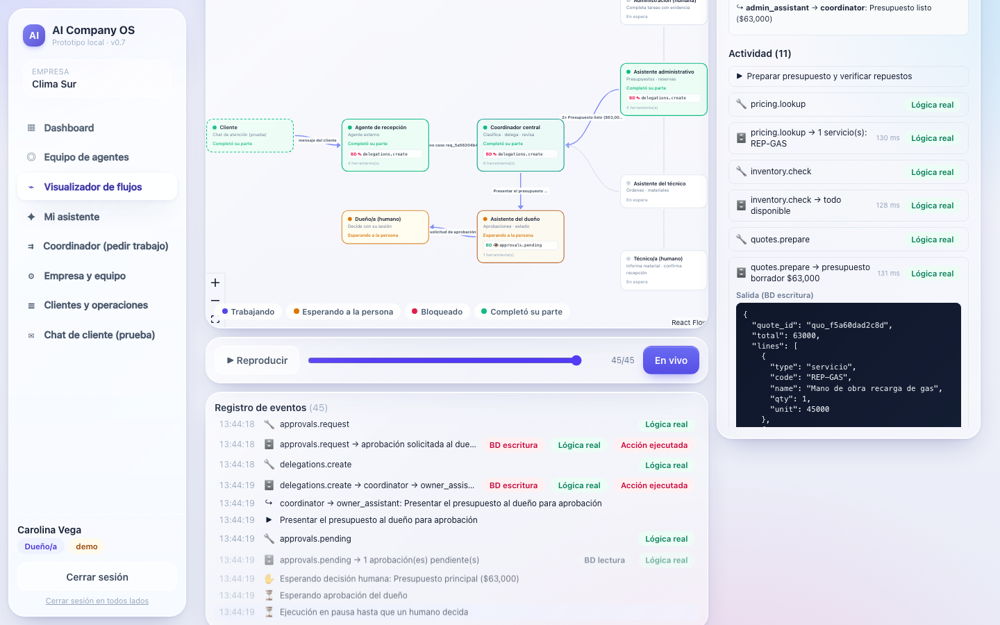
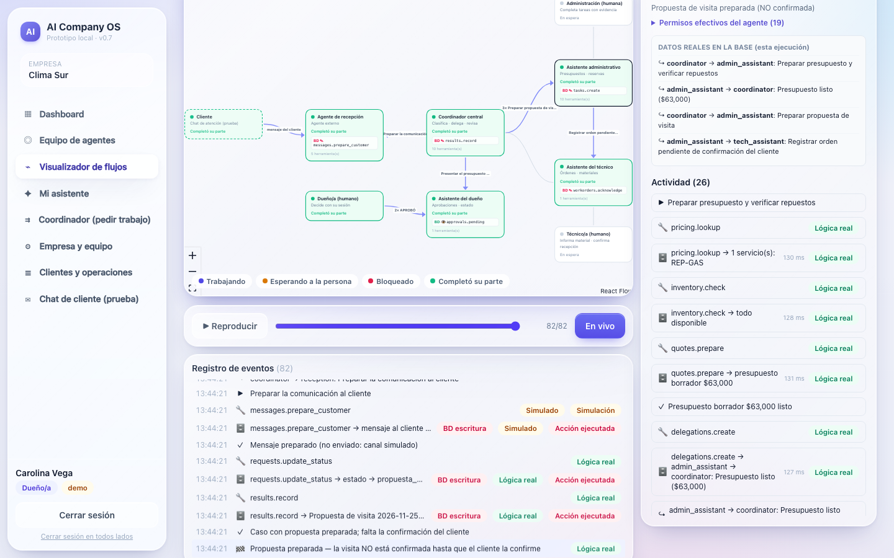
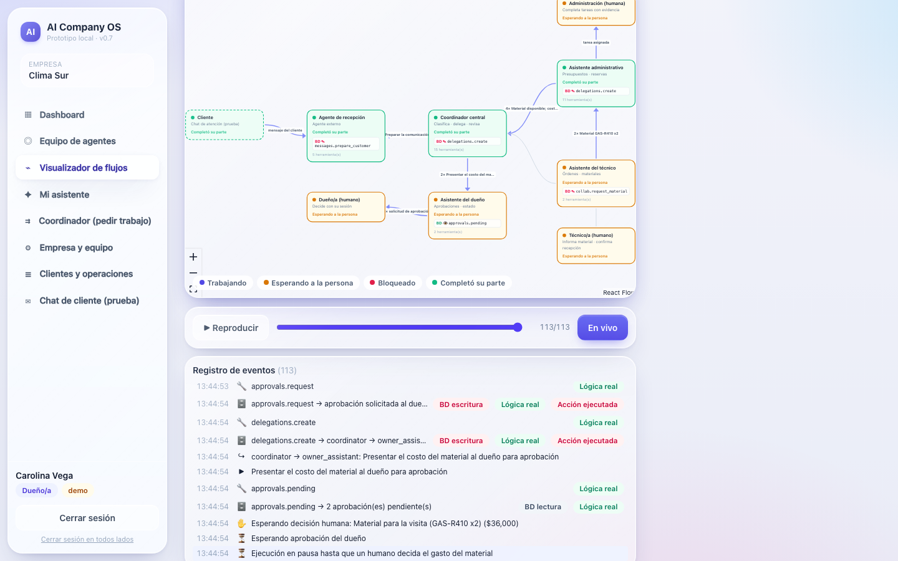
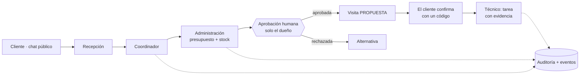

# AI Company OS

**Un equipo de agentes de IA que trabaja a la vista: permisos reales, aprobación humana en cada decisión que importa y trazabilidad completa.**
Prototipo local multiempresa para negocios de servicios técnicos. **Datos 100 % ficticios.**

> **In English (30 s):** a multi-tenant platform where each company has a team of AI *roles* (reception, coordinator, per-employee assistants) that collaborate through a closed tool registry with real permissions, human approvals, idempotent state machines and an audit trail. It is a **local prototype with fictitious data**: no real identity provider, MFA, e-mail/WhatsApp or deployment. The interesting part is the engineering evidence: 752 automated tests, 113 mutation checks, cross-tenant isolation matrices, a static tenancy audit and real-browser E2E.

## Lo que NO es (léelo primero)
- **No es un SaaS en producción.** Corre en tu máquina (`127.0.0.1`); no hay despliegue, dominio, pagos ni usuarios reales.
- **No hay proveedor de identidad real, MFA ni correo.** La identidad externa se prueba solo contra un proveedor **simulado inyectado en las pruebas**, que el modo piloto se niega a arrancar. WhatsApp, correo, telefonía y pagos **no existen** (los mensajes quedan como borradores «preparado, no enviado»).
- **Los «agentes» son roles lógicos**: código determinista + herramientas con permisos. Un LLM local es opcional y solo *propone*; el motor valida.
- **No es una certificación de seguridad.** Es un laboratorio con datos de prueba; lo que se probó y lo que no está en [`docs/v07/`](docs/v07/).

## Míralo en 3 minutos
| El dueño aprueba antes de que algo ocurra | La ejecución termina con evidencia y auditoría | Dos personas, dos permisos, un solo plan |
|---|---|---|
|  |  |  |

Flujo (cada flecha es una fila persistida y un evento visible en el visualizador):



## Ejecutarlo (un comando)
Requisitos: [`uv`](https://docs.astral.sh/uv/), Node ≥ 20 (Python 3.12 lo instala `uv`).
```bash
./run_demo.sh                 # crea el entorno, compila el frontend y abre http://127.0.0.1:8731
PORT=8790 ./run_demo.sh       # otro puerto
```
Cuentas **ficticias** (contraseña `demo1234`, rotuladas en la pantalla de entrada): `dueno@climasur.test`, `admin@climasur.test`, `tecnico@climasur.test` (y las de Motor Norte). Recorridos paso a paso: [`docs/demo/RUNBOOK_DEMO.md`](docs/demo/RUNBOOK_DEMO.md).

## Qué hay adentro
```
frontend (Vite + React + TS + Tailwind + React Flow) ──HTTP/SSE──▶ backend FastAPI (un solo proceso)
                                                                   ├─ api.py       sesión → empresa; permisos de rol; CSRF; límites
                                                                   ├─ engine/      orquestador por fases (máquina de estados, CAS, lease)
                                                                   ├─ tools/       registro: permiso → validación → transacción → auditoría
                                                                   ├─ identity*/   interfaz de proveedor, invitaciones, auth_time (V0.7)
                                                                   └─ db.py        SQLAlchemy Core (SQLite → PostgreSQL cambiando una URL)
```
Decisiones y *trade-offs*: [`docs/ARCHITECTURE.md`](docs/ARCHITECTURE.md). Hoja de ruta honesta hacia un piloto: [`docs/ROADMAP_V1_PRODUCTO.md`](docs/ROADMAP_V1_PRODUCTO.md).

## Cómo se probó (con el comando para reproducirlo)
| Qué | Resultado | Cómo reproducirlo |
|---|---|---|
| Pruebas automáticas de API, motor, seguridad, persistencia y recuperación | **752** | `cd backend && .venv/bin/python -m pytest -q` |
| **Matriz de aislamiento entre empresas** generada del OpenAPI vivo y del registro de herramientas (una ruta o herramienta con id sin caso hace fallar la prueba) | incluida en las 752 | `pytest backend/tests/test_v07_cross_tenant_matrix.py` |
| **Pruebas de mutación**: se rompe UNA propiedad de seguridad cada vez en una copia y las pruebas deben notarlo | **113** (29 + 45 + 39) | `python qa/mutations_v07_p1.py` · `…_p2.py` · `…_p25.py` |
| Auditoría estática: toda consulta sobre una tabla de empresa filtra por `company_id` o está justificada una a una; toda ruta anónima está documentada | 0 sin justificar | `python qa/audit_identity_tenancy.py --check` |
| Navegador real (Chromium): regresión A–E, demo guiada, modo piloto con cookie `__Host-` y reautenticación | 13 + 4 + 2 | `cd frontend && npx playwright test` (y `-c playwright.demo.config.ts`, `-c playwright.pilot.config.ts`) |
| Saneamiento de este repositorio (rutas, correos, claves, nombres internos) con su propia prueba de mutación | 0 hallazgos | `python tools/check_showcase.py` |

Una anécdota que resume el enfoque: el CI falló una vez en una prueba de navegador. En vez de subir el *timeout*, se **reprodujo sin navegador** (8 de 8 ejecuciones atascadas), se halló una **carrera real del motor** («aprobación decidida antes de que la ejecución espere»), se corrigió con una transición atómica y se fijó con 15 pruebas deterministas (eventos y barreras, sin dormir).

## Qué es real y qué es simulado
| Real | Simulado / inexistente |
|---|---|
| Base de datos, multiempresa, permisos, auditoría, idempotencia, aprobaciones, tareas, delegaciones, eventos | Mensajes al cliente (WhatsApp/correo): borradores no enviados |
| Autenticación con contraseña (argon2id), sesiones en servidor, CSRF, límites persistentes, cabeceras del modo piloto | Proveedor de identidad externo, MFA, correo de invitaciones: solo contra un simulado **de pruebas** |
| Coordinación entre roles (máquina de estados determinista), cierre de tareas **solo con evidencia** | Telefonía, pagos, calendarios, reloj de vencimientos en segundo plano |

Detalle: [`docs/demo/REAL_VS_SIMULADO.md`](docs/demo/REAL_VS_SIMULADO.md).

## Límites honestos
Una sola máquina y SQLite; sin recuperación de contraseña ni TLS propios; probado con español y un caso de servicio técnico; un fallo de ejecución no se reintenta solo (decisión deliberada: reintentar sin reconciliar efectos podría duplicar trabajo). Pendientes explícitos del camino a un piloto (proveedor real, MFA verificado, hosting, región de datos, contratos): [`docs/v07/`](docs/v07/).

## Mapa de documentos
**Empieza por el [caso de estudio](docs/CASO_DE_ESTUDIO.md)** (cuatro historias de ingeniería con su evidencia) · [`docs/ARCHITECTURE.md`](docs/ARCHITECTURE.md) · [`docs/v06/`](docs/v06/) acceso y sesiones, copias y restauración, límites del canal público, recuperación de ejecuciones · [`docs/v07/`](docs/v07/) auditoría de identidad y tenancy, modo piloto, identidad e invitaciones, vínculo del dueño · [`docs/demo/`](docs/demo/) guion y runbook · [`qa/`](qa/) herramientas de auditoría y mutación.

## Cifras y su fuente
Las cifras de este README salen de estos comandos, ejecutados sobre un clon limpio de este repositorio: `pytest --collect-only -q` (752) · `python qa/mutations_v07_p{1,2,25}.py --list | wc -l` (29, 45, 39) · listas de pruebas de `frontend/e2e*` (13 + 4 + 2).

## Licencia
Por definir por el autor antes de publicar (ver `SANEAMIENTO.md` y la especificación en `specs/`).
