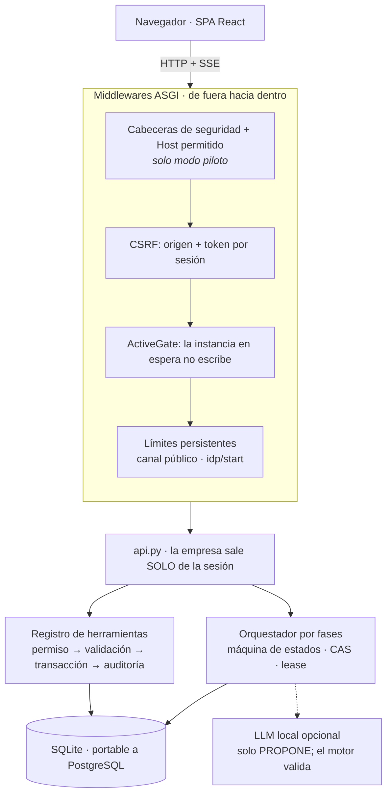

# Arquitectura v0.7 — diagramas

Complementa [`ARCHITECTURE.md`](ARCHITECTURE.md) (decisiones de fondo, escrito en v0.5) con lo que se añadió después. Los diagramas son Mermaid (GitHub los dibuja).

## 1. Capas y confianza


## 2. Aislamiento entre empresas
```mermaid
sequenceDiagram
  participant B as Navegador (empresa B)
  participant A as API
  participant D as Base de datos
  B->>A: GET /api/requests/{id de la empresa A}
  A->>A: empresa = la de la SESIÓN (nunca del cuerpo)
  A->>D: SELECT … WHERE id=:id AND company_id=:empresa_de_la_sesión
  D-->>A: ninguna fila
  A-->>B: 404 (idéntico al de un id que no existe)
  Note over A,D: la guarda estática exige este filtro en cada consulta;<br/>la matriz de pruebas lo verifica generada del OpenAPI
```

## 3. Esperar una aprobación sin perder la decisión
```mermaid
sequenceDiagram
  participant E as Motor (hilo de la ejecución)
  participant DB as Base de datos
  participant H as Dueño (decide)
  E->>DB: crea la aprobación (ya visible)
  Note over E,H: ventana: la ejecución aún está «running»
  H->>DB: escribe la decisión; intenta CAS waiting_approval→running
  Note right of H: si la ejecución aún no espera, el CAS no encuentra fila
  E->>DB: UNA transacción: running→waiting_approval y RELEE esa aprobación
  alt ya estaba decidida
    E->>DB: CAS waiting_approval→running/decided
    E->>E: solo quien gana el CAS reanuda
  else sigue pendiente
    Note over E,H: espera; el CAS de la decisión reanudará
  end
```

## 4. Invitar a alguien (identidad)
```mermaid
sequenceDiagram
  participant D as Dueño
  participant A as API
  participant P as Proveedor de identidad<br/>(simulado SOLO en pruebas)
  participant E as Invitado
  D->>A: crear invitación (correo, rol) · autenticación reciente + CSRF
  A-->>D: enlace con secreto (solo su hash queda en la base; 7 días, un uso)
  E->>A: idp/start (secreto) → state + PKCE + nonce + cookie de correlación
  E->>P: se registra y verifica su correo
  P-->>A: callback (code, state)
  A->>A: quema el flujo ANTES de hablar con el proveedor
  A->>P: canjea el código
  P-->>A: subject, correo verificado, auth_time
  A->>A: correo = el invitado · rol y empresa SOLO de nuestra base
  A-->>E: sesión propia (cookie __Host- en el piloto)
```
