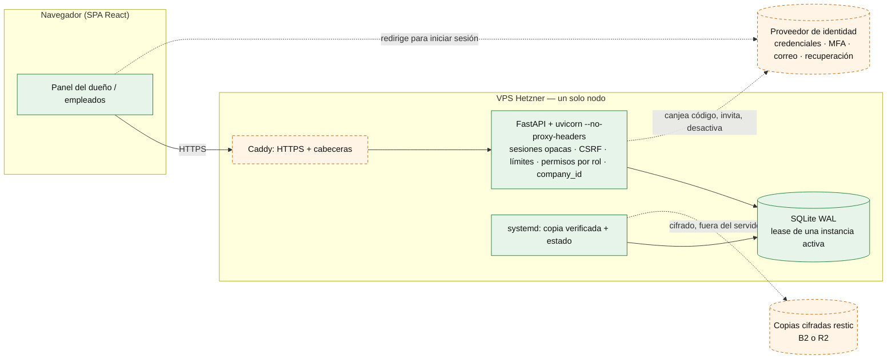
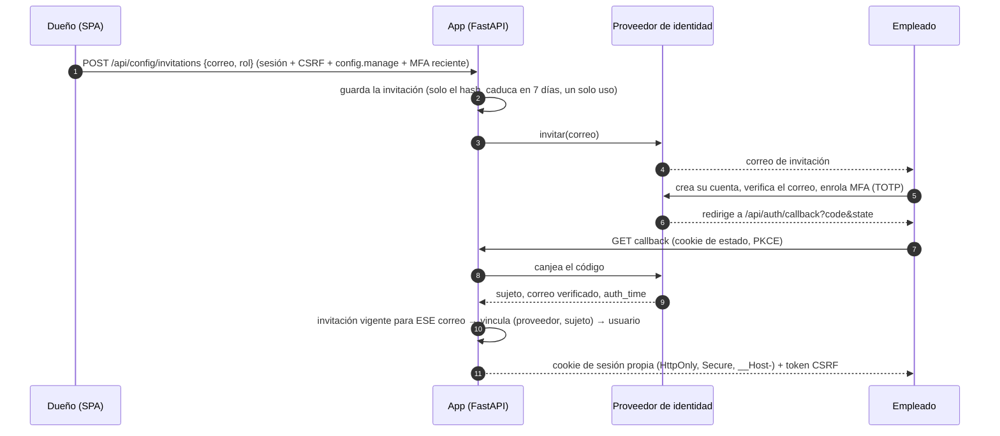

# V0.7 · P0 · Arquitectura mínima del piloto privado y plan de entrega

**Fecha:** 2026-11-23 · **Issue:** #17 · **Base:** `main` `97b8194` · **Hechos y fuentes:** [`P0_AUDITORIA_IDENTIDAD_Y_TENANCY.md`](P0_AUDITORIA_IDENTIDAD_Y_TENANCY.md) y [`P0_COMPARATIVA_Y_RECOMENDACION.md`](P0_COMPARATIVA_Y_RECOMENDACION.md).
> **Esto es un diseño.** Nada de lo marcado «nuevo» existe en `main`. No se desplegó nada, no se creó ninguna cuenta ni servidor, no se tocaron `aicos.db`, `demo_comercial.sqlite3` ni los puertos 8731/8743/8750/8000. Coste real de esta fase: **US$ 0**.

## 1. En una página

* **Piloto:** una empresa **ficticia** de servicios técnicos (aire acondicionado), 3–6 personas de prueba, invitación solamente, **datos sintéticos**. No es un SaaS público y no tiene registro abierto.
* **Identidad:** las **credenciales** (alta, contraseña, recuperación, MFA, correos) las lleva un **proveedor gestionado** (recomendado: WorkOS AuthKit, plan gratuito, MFA obligatorio) tras una interfaz propia estrecha; la app conserva **sus sesiones opacas, CSRF, permisos, `company_id` y auditoría** (todo ya probado en V0.6).
* **Datos:** **SQLite** + copias verificadas + restic cifrado. **PostgreSQL aplazado** con disparadores explícitos.
* **Hosting:** **un VPS** (Hetzner CPX12, ≈ € 10/mes) con **Caddy** (HTTPS automático) y **systemd** (lo que ya generamos en V0.6), opcionalmente tras Cloudflare Access.
* **Primer incremento (P1, 2–3 días):** **modo `pilot`** que apaga la superficie de demostración y falla cerrado si la configuración es insegura, **cabeceras de seguridad**, y la **prueba generada de cruce entre empresas**. No necesita credenciales, ni proveedor, ni despliegue.

## 2. Arquitectura objetivo (lo existente en verde, lo nuevo en naranja)

*(Verde = existe en `main` y está probado; naranja = nuevo en V0.7 o **no conectado todavía**: restic está construido y probado en V0.6 pero sin destino ni cuenta.)*

### Inicio de sesión de un empleado invitado

## 3. Modelo de identidad y empresa (diseño)

**Tablas nuevas** (migración aditiva; no se toca ninguna fila existente):
* `identities(provider, subject, user_id, company_id, created_at, last_login_at)` con `UNIQUE(provider, subject)`: **a quién corresponde** una identidad externa. Los inicios de sesión posteriores usan `(provider, subject)`, **nunca el correo** (un cambio de correo en el proveedor no cambia de cuenta).
* `invitations(id, company_id, email_key, role, token_hash, status, created_by, created_at, expires_at, accepted_at, revoked_at)`.
* `sessions.auth_time` (instante de la última autenticación activa en el proveedor).

**Reglas** (cada una con prueba, §6):
1. **Sin aprovisionamiento automático.** Una identidad verificada **sin invitación vigente ni vínculo** recibe la misma respuesta genérica que cualquier fallo (no se revela si el correo existe).
2. La invitación fija **correo, rol y empresa**; solo la crea quien tiene `config.manage` (el dueño), caduca en 7 días, es de un solo uso y se puede revocar; **una vigente por correo**; con límite de tasa y auditoría. El correo del proveedor debe venir **verificado** y ser **el invitado**.
3. **El rol y la empresa salen de nuestra base**, nunca de lo que diga el proveedor; el proveedor solo responde «quién es».
4. En el piloto el **inicio de sesión con contraseña local queda desactivado** y `users.password_hash` guarda un valor no verificable; el dueño deja de conocer o fijar contraseñas (cierra H4).
5. **Revocación:** desactivar a un empleado borra sus sesiones (ya existe) **y** pide al proveedor desactivar la identidad; `logout-all` no cambia.
6. **Paso adicional («step-up»):** las operaciones sensibles (`config.manage`, `approvals.decide`, administrar copias, exportar/borrar datos) exigen `auth_time` reciente (p. ej. ≤ 15 min); si no, `401 reauth_required` y la SPA reautentica. Como WorkOS **no** emite `amr/acr`, la garantía de MFA es «**MFA obligatorio en cada inicio de sesión**» + frescura de `auth_time` (ver comparativa §2). Una sesión sin `auth_time` se considera vencida.
7. **CSRF, límites de intentos, `ActiveGate`, lease y `company_id` no cambian.** El *callback* queda exento de CSRF (es una navegación `GET` de redirección) pero atado a `state` + PKCE + cookie de estado de un solo uso.

**Interfaz estrecha del proveedor** (para poder cambiarlo): `authorize_url(state, nonce, challenge, login_hint)`, `exchange(code, verifier) → {subject, email, email_verified, name, auth_time}`, `invite(email)`, `disable(subject)`, `logout_url()`. Adaptadores: `FakeProvider` (pruebas y desarrollo local, sin red ni credenciales), `WorkOSProvider` (P3), a futuro `OidcProvider` (Cognito/Keycloak).

## 4. Entornos: `AICOS_ENV` (diseño del primer incremento)

| Aspecto | `local` (hoy, **por defecto**) | `demo` (hoy: `AICOS_DEMO_MODE=1`) | **`pilot`** (nuevo) |
|---|---|---|---|
| Empresas de demostración sembradas en una base vacía | sí | sí | **no** (base vacía; alta por el operador con la CLI) |
| `GET /api/auth/demo-accounts` (hoy devuelve la contraseña) | sí | sí | **404** |
| `/demo`, `/demo-login/*`, `/api/demo/*` | no / no / sí | sí | **404** |
| `/api/setup/*` | solo con la bandera y loopback | igual | **404** |
| Cookie | `aicos_session`, `Secure` si https | igual | **`__Host-aicos_session`**, `Secure` forzado, `Path=/`, sin `Domain` |
| Cabeceras | ninguna | ninguna | **HSTS, `nosniff`, `Referrer-Policy`, `frame-ancestors 'none'`, `Cache-Control: no-store` en `/api/*`, CSP en modo informe** |
| Arranque | sin comprobaciones | preflight de demostración | **falla cerrado** (abajo) |
| Contraseña local | sí | sí | sí en P1; **desactivada** al configurar el proveedor (P2) |

**El arranque en `pilot` se niega a continuar** (mensaje claro, sin secretos, código de salida ≠ 0) si: `AICOS_COOKIE_SECURE` no es `1` · `AICOS_TRUSTED_ORIGINS` está vacío · `AICOS_DEMO_MODE=1` · `AICOS_ALLOW_COMPANY_CREATION=1` · la base contiene usuarios `is_demo=1`. Con `AICOS_ENV` sin definir, **todo se comporta como hoy** (374 pruebas y Playwright 12 + 4 sin cambios).

## 5. Staging privado (diseño; **nada se contrata ni se despliega en este Issue**)

| Tema | Diseño |
|---|---|
| Servidor | 1 VPS CPX12 (2 GB). Acceso por clave SSH, sin contraseña ni `root`; `ufw` solo 80/443 (+ SSH restringido); actualizaciones de seguridad automáticas |
| HTTPS | Caddy con certificado automático (necesita un dominio de prueba); HSTS desde la app |
| Procesos | `systemd`: la app (`uvicorn --no-proxy-headers`, un proceso), y los **timers de copia y de estado ya generados en V0.6** (`python -m app.backup_routine schedule --kind systemd`) |
| Secretos | archivo de entorno `0600` fuera del repositorio (secreto del proveedor, contraseña de restic); **nunca** en Git, en el diario ni en el checkpoint |
| Registros mínimos | `journald` con retención corta; sin cuerpos de petición; IP truncada o con HMAC (H7) |
| Alertas | `status` cada 6 h ya existe; **falta el canal** (decisión del dueño). Mínimo viable: el servicio de estado falla y `systemd` lo marca; aviso real = Telegram/correo, por decidir |
| Copias y restauración | rutina de V0.6 + restic a B2/R2; **ensayo de restauración semanal** sobre una base de pruebas; recuperación documentada |
| Presupuesto | el servidor tiene tope de factura mensual propio del proveedor (Hetzner: «la factura nunca supera el precio mensual») [oficial]; **tope acordado: € 25/mes** en total, con aviso al superarse el 80 % |
| Retorno atrás (*rollback*) | cada versión en su directorio + enlace simbólico; **copia de la base antes de cada migración** (ya existe `_backup_before_migration`) |
| Retención y borrado | datos sintéticos: se borran con la empresa; procedimiento de **exportación y borrado de una persona** (backlog P4) |

## 6. Primer incremento ejecutable: **V0.7 P1 «modo piloto + red de seguridad del aislamiento»**

**Por qué primero y pequeño:** quita los riesgos más graves de la auditoría (H1–H3, H6) sin depender de ninguna decisión del dueño ni de ningún proveedor, y deja una **red de seguridad** (pruebas de cruce) **antes** de tocar identidad. Estimación: **2–3 días**, un PR, **sin migración de esquema**, sin credenciales, sin red.

**Alcance:** `AICOS_ENV` (§4) · apagado de la superficie de demostración en `pilot` · `seed` sin demostración en `pilot` · comprobaciones de arranque · cookie `__Host-` · cabeceras · **prueba generada de cruce entre empresas** · (la guardia estática de rutas anónimas y consultas **ya está en este PR de P0**).
**Fuera de alcance:** proveedor, invitaciones, MFA, despliegue, PostgreSQL.

**Criterios de aceptación (cada uno con su prueba, escrita **en rojo primero**):**

| # | Criterio | Prueba |
|---|---|---|
| AC1 | Sin `AICOS_ENV`, el comportamiento es **idéntico** al de hoy | las 374 pruebas existentes + Playwright 12 + 4 pasan sin tocar una línea de prueba |
| AC2 | `AICOS_ENV=pilot` y una base nueva: **cero empresas**, `demo-accounts` / `demo*` / `setup*` → 404 y la pantalla de entrada no muestra cuentas | `test_pilot_starts_empty_and_hides_the_demo_surface` |
| AC3 | `pilot` **se niega a arrancar** en cada una de las 5 configuraciones inseguras (§4) con un mensaje que nombra la variable y **no** imprime valores | parametrizada, 5 casos (4 variables + «una base con usuarios de demostración») |
| AC4 | En `pilot` la cookie se llama `__Host-aicos_session`, es `Secure`, `Path=/` y no lleva `Domain`; las cabeceras de §4 están en **todas** las respuestas de `/api/*` | `test_pilot_cookie_and_headers` (cliente `https://`) |
| AC5 | **Cruce entre empresas generado desde la tabla de rutas:** para cada ruta con sesión y un identificador en la ruta, llamada como la empresa B con ids de la A → **404/403 y ni un dato de A**; las listas de B no contienen filas de A; los flujos SSE de A no llegan a B | `test_cross_tenant_matrix` (parametrizada por ruta; falla si aparece una ruta con identificador **sin** caso) |
| AC6 | Un `GET` con el token del canal público de la empresa A **no** abre nada de B | `test_public_token_is_scoped_to_its_company` |
| AC7 | La guardia estática exige justificar toda ruta anónima o consulta sin `company_id` nuevas | `test_v07_audit_tool.py` (**ya incluido**: 4 pruebas) |
| AC8 | CI verde (pytest + build + Playwright 12 + 4 + demo); mutaciones: quitar el apagado de `demo-accounts`, quitar un `company_id` o aceptar una cookie sin `__Host-` hace caer **una** prueba | script de mutaciones como en #13/#15 |

## 7. Plan de entregas (en orden) y plan de pruebas

| Etapa | Entrega | Estimación* | Necesita autorización del dueño |
|---|---|---|---|
| **P0** (este PR) | auditoría, comparativa, arquitectura, guardia estática | hecho | — |
| **P1** | modo `pilot`, cabeceras, cruce entre empresas (§6) | 2–3 d | no |
| **P2** | interfaz de proveedor + `identities`/`invitations` + `FakeProvider` + `/api/config/invitations` + `/api/auth/callback` + `auth_time` y *step-up*; **todo con el proveedor falso** | 4–5 d | no |
| **P3** | *spike* de medio día con el **plan gratuito** de WorkOS (entorno de pruebas) + adaptador `WorkOSProvider`; comprobar lo no verificado (comparativa §8.4) | 1–2 d | **sí**: crear la cuenta gratuita |
| **P4** | MFA obligatorio comprobado, desactivación sincronizada con el proveedor, exportación/borrado de una persona, IP minimizada (H7) | 2–3 d | no |
| **P5** | staging privado: VPS + Caddy + systemd + restic, ensayo de restauración, medición de capacidad, runbooks (§5) | 3–4 d | **sí**: servidor, dominio, destino de copias |
| **P6** | QA de acceso hostil: cruce entre empresas con *fuzz*, abuso de invitaciones, sesión robada; mapa ASVS por tema | 2–3 d | no |
| **P7** | **piloto sintético** (1–2 semanas) con el flujo de §8 y las métricas; decisión de seguir o no | 1–2 sem | **sí**: personas de prueba informadas |
*Estimaciones de desarrollo en días-persona: **juicio, no medición**; total ≈ 15–20 días de código hasta P6.

**Plan de pruebas (rojo → verde; CI en Linux como hoy):**

| Área | Casos que deben existir |
|---|---|
| Invitaciones (P2) | válida · caducada · reutilizada · correo distinto · otra empresa · revocada · solo `config.manage` · sin CSRF → 403 · límite de tasa · **misma respuesta** exista o no el correo · auditoría de cada paso |
| Callback del proveedor (P2) | `state` distinto · PKCE incorrecto · código caducado/reutilizado · correo **no verificado** · identidad sin invitación · identidad ya vinculada a otro usuario · proveedor caído → **no** se crea sesión (falla cerrado) |
| MFA / *step-up* (P2, P4) | operación sensible con `auth_time` viejo → `reauth_required` · tras reautenticar pasa · sesión sin `auth_time` = vencida · desactivar usuario mata sesiones y pide la baja al proveedor |
| Cruce entre empresas (P1, P6) | matriz generada de rutas · SSE · canal público · ids de A como B · exportación/borrado |
| CSRF y límites (todos) | las pruebas actuales + el callback no es un vector de *login CSRF* |
| Fallo y restauración (P5) | `restore` borra sesiones y **conserva** `identities`/`invitations`; el ensayo de arranque sobre una copia en modo `pilot` no siembra la demostración; migración sobre una base V0.6 |
| Compatibilidad de la demostración (todos) | Clima Sur, Motor Norte y Aire Austral intactos: suite A–E y Playwright 12 + 4 en `local`/`demo` |
| E2E Playwright (P2+) | el dueño invita → el empleado acepta (proveedor falso) → entra → ve solo lo suyo → el dueño lo desactiva → su sesión muere → una URL de la empresa B da 404 |

## 8. Vertical inicial y flujo de extremo a extremo

**Vertical:** servicio técnico de **aire acondicionado** (el flujo de Clima Sur ya probado), en una **empresa nueva y ficticia** creada con la CLI del operador (no con la siembra de demostración).

| Paso | Qué ocurre | Estado |
|---|---|---|
| 1. Solicitud del cliente | chat del canal público (`/api/public/{slug}/chat`) con límites persistentes | **real** (código y límites) · canal **simulado** (sin WhatsApp ni correo reales) |
| 2. El coordinador propone el plan | motor determinista (LLM local opcional); el plan solo usa herramientas del registro | **real** |
| 3. Un humano aprueba | `approvals.decide` solo para el dueño; ningún agente lo posee | **real** |
| 4. Asignación a un empleado | pasos del plan → tareas con responsable y disponibilidad | **real** |
| 5. Tarea y evidencia | el técnico completa con evidencia escrita | **real** (sin fotos ni archivos) |
| 6. Cierre y auditoría | resultados, compromisos y `audit_log` | **real** |
| Cuentas, invitaciones, MFA | proveedor de identidad | **pendiente** (P2–P4) |
| WhatsApp / correo / voz / pagos | integraciones `simulado` | **pendiente** (V0.8; **no** se elige canal sin entrevistas) |

**Métricas que justificarían un precio** (**no validadas**; se miden en P7 contra una línea base que la empresa describa antes): (1) minutos desde la solicitud hasta el plan aprobado (mediana); (2) % de trabajos cerrados **con evidencia**; (3) compromisos vencidos sin seguimiento por mes; (4) horas semanales de coordinación del dueño y administración (autoinforme, 2 semanas antes y después). Ninguna es una promesa de resultado.

## 9. Riesgos y decisiones del dueño

1. **Aprobar P1 tal como está** (alcance, 2–3 días, sin gasto).
2. **Autorizar el spike gratuito (P3):** crear una cuenta gratuita de WorkOS (entorno de pruebas). Sin tarjeta ni datos reales.
3. **Región de los datos y contrato de tratamiento** con el proveedor de identidad, y **confirmar la vigencia de la Ley 21.719 en LeyChile** (hoy: postergación **no** publicada, vigencia 2026-12-01 salvo que se publique antes).
4. **Servidor y dominio** (≈ € 10/mes + dominio) para P5, y el **tope de gasto** (€ 25/mes propuesto).
5. **Canal de alerta** (Telegram o correo) para el `status` de las copias y la salud.
6. **MFA obligatorio para todos** los usuarios del piloto (recomendado por ser ≤ 20 personas).
7. Quiénes son las **personas de prueba** y que se les informa del tratamiento de su correo y nombre.
* **Riesgos técnicos que quedan:** dependencia del proveedor (mitigada por la interfaz estrecha); `amr/acr` ausentes en WorkOS (mitigado con MFA obligatorio + `auth_time`; a comprobar en el spike); SQLite en un nodo (disparadores en la comparativa §4); latencia no medida; el Mac del dueño **no** es servidor.
